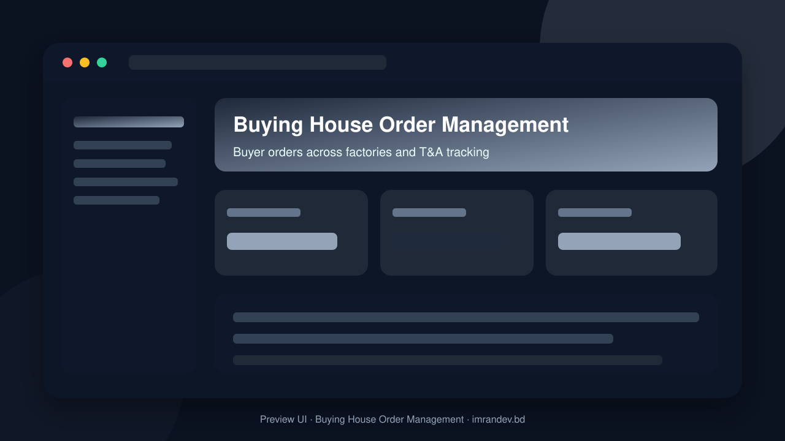
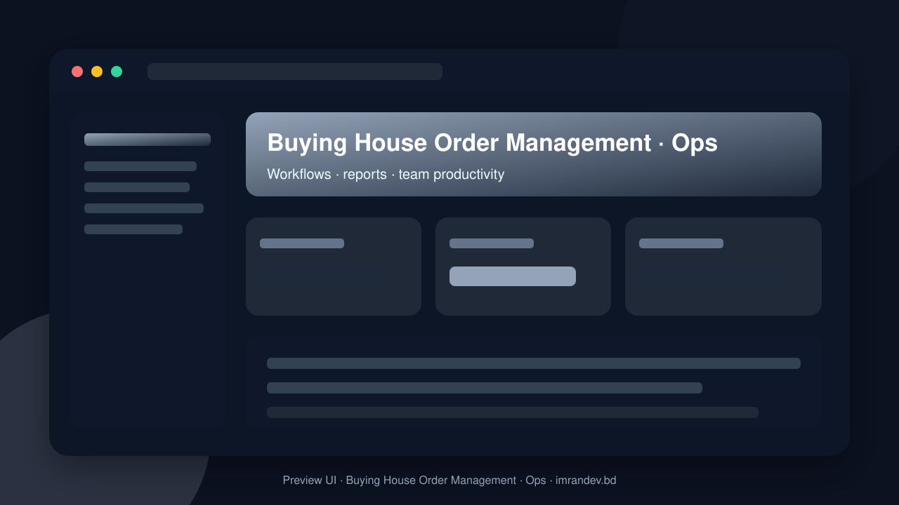

<p align="center">
  
</p>

<h1 align="center">Buying House Order Management</h1>

<p align="center"><strong>Buyer orders across factories and T&A tracking</strong></p>

<p align="center">
  <a href="https://github.com/imranbru99/buying-house-order-management-factories"></a>
  
  
</p>

---

## Overview

**Buying House Order Management** is a complete business application focused on real operational workflows. This README lists the full feature surface so GitHub visitors and search engines can understand every capability of the product.

## Product preview

| Dashboard | Operations |
| :---: | :---: |
|  |  |

## Complete feature list

### Product modules & capabilities

- Order Management for Buying Houses
- Buying-house users
- Bill of Materials
- Company Management
- Buyer Management
- Factory Management
- Supplier Management
- Product Management
- Inquiry and RFQ
- Sample Management
- Buyer Orders
- Factory Work Orders
- Procurement
- LC Management
- Finance
- Attendance
- Advanced Analytics
- Buying House Dashboard
- Production Manager
- QA Manager
- Finance Manager

### Admin / Filament resources

- Buyer Purchase Order
- Buyer
- Costing Sheet
- Document
- Factory Allocation
- Factory
- Factory Work Order
- Inquiry
- Inspection
- Invoice
- Letter Of Credit
- Plan
- Production Update
- Purchase Order
- Sample Approval
- Sample
- Shipment
- Style
- Supplier Purchase Order
- Supplier
- Task
- Tenant
- Tna Milestone
- Work Order

### Domain models

- Activity Log
- Approval
- Audit
- Audit Log
- Bill Of Material
- Branch
- Buyer
- Buyer Contact
- Buyer Purchase Order
- Buyer Purchase Order Item
- Certification
- Commercial Invoice
- Commission
- Company
- Compliance Issue
- Corrective Action
- Costing Item
- Costing Sheet
- Delivery Schedule
- Department
- Document
- Employee
- Exchange Rate
- Expense
- Factory
- Factory Allocation
- Factory Contact
- Factory Work Order
- Has Uuid
- Inquiry
- Inspection
- Inspection Defect
- Invoice
- Lc Amendment
- Letter Of Credit
- Material
- Material Receipt
- Notification Preference
- Order Color
- Order Size
- Order Tna Schedule
- Packing List
- Payment
- Plan
- Plan Module
- Product Category
- Production Plan
- Production Update
- Proforma Invoice
- Purchase Requisition

### HTTP / API controllers

- Allocation APIs & screens
- Auth APIs & screens
- Buyer APIs & screens
- Document APIs & screens
- Factory APIs & screens
- Inspection APIs & screens
- Order APIs & screens
- Production APIs & screens
- Sample APIs & screens
- Shipment APIs & screens
- Style APIs & screens
- Website APIs & screens
- Work Order APIs & screens

### Detailed feature requirements delivered

- PROJECT IDENTITY
- Application Name: Order Management for Buying Houses
- Primary Tagline: Manage Every Buyer Order, Every Factory, Every Shipment.
- Product Category: Buying House ERP / Garment Order Management / Apparel Manufacturing Coordination / B2B SaaS.
- TECHNOLOGY STACK
- REQUIRED PACKAGES
- Important: Filament must remain the primary administration framework because this project explicitly requires Filament.
- COMPLETE MULTI-TENANT SAAS ARCHITECTURE
- COMPLETE USER TYPES AND ROLE MANAGEMENT
- MULTIPLE FILAMENT PANELS
- CORE BUSINESS MODULES
- MODULE 01: Company Management
- MODULE 02: Buyer Management
- MODULE 03: Factory Management
- MODULE 04: Supplier Management
- MODULE 05: Product and Style Management
- MODULE 06: Inquiry and RFQ Management
- MODULE 07: Costing Management
- MODULE 08: Sample Management
- MODULE 09: Buyer Purchase Order Management
- MODULE 10: Order Allocation Across Factories
- Buyer PO: PO-2026-001
- Total quantity: 100,000 pieces.
- Factory A: 40,000 pieces.
- Factory B: 35,000 pieces.
- Factory C: 25,000 pieces.
- MODULE 11: Factory Work Order Management
- MODULE 12: TNA and Critical Path Management
- MODULE 13: Production Planning and Monitoring
- MODULE 14: Quality Control and Inspection
- MODULE 15: Compliance and Audit Management
- MODULE 16: Material and Procurement Management
- MODULE 17: Shipment and Logistics Management
- MODULE 18: Commercial and Trade Documentation
- MODULE 19: Letter of Credit and Payment Tracking
- MODULE 20: Finance and Accounts
- MODULE 21: HR and Employee Management
- MODULE 22: CRM and Communication
- MODULE 23: Document Management System
- MODULE 24: Task and Approval Management
- MODULE 25: AI Business Assistant
- MODULE 26: AI Catalog and Authorized Data Import
- MODULE 27: Notification Center
- MODULE 28: Reporting and Analytics
- MODULAR ON/OFF SYSTEM
- MULTIPLE SUBSCRIPTION PLANS
- DASHBOARD DESIGN
- Default design: Premium Light UI with optional dark mode.
- PUBLIC WEBSITE
- DATABASE DESIGN
- API AND INTEGRATION ARCHITECTURE
- GLOBALIZATION
- SECURITY AND COMPLIANCE
- COMPLETE README.MD
- UI/UX REQUIREMENTS
- TESTING REQUIREMENTS
- PERFORMANCE AND SCALABILITY
- DEVELOPMENT WORKFLOW
- Phase 1: Repository and architecture
- Phase 2: Foundation
- Phase 3: Core buying-house operations
- Phase 4: Operational management
- Phase 5: Business management
- Phase 6: Advanced functionality
- Phase 7: Public website
- Phase 8: Demo and testing
- Phase 9: Final documentation and deployment
- IMPORTANT CODING RULES
- FINAL ACCEPTANCE CRITERIA
- FINAL DELIVERY EXPECTATIONS

### Platform capabilities

- Multi-role ready structure for operators, managers and admins
- Database migrations and seeders for demo-ready local setup
- Laravel architecture with services/controllers/models separation
- Responsive UI foundation (Blade / Filament where enabled)
- Environment-based config for local and production databases
- GitHub-ready documentation with visual product previews

## Tech stack

- PHP 8.2+ / Laravel
- Filament admin resources (where enabled)
- Vite asset pipeline
- SQLite/MySQL-ready database layer
- Migrations, seeders, and test-ready structure

## Quick start

```bash
git clone https://github.com/imranbru99/buying-house-order-management-factories.git
cd buying-house-order-management-factories
composer install
cp .env.example .env
php artisan key:generate
php artisan migrate --seed
npm install && npm run build
php artisan serve
```

## Repository

- GitHub: https://github.com/imranbru99/buying-house-order-management-factories
- Developer: **Imran Ahmed** · https://imrandev.bd

---

## 🤝 Let's Connect & Collaborate

I am open to **Senior Remote Full-Stack Roles**, AI Platform Architecture Contracts, and Enterprise Technical Advisory.

**Timezone:** UTC+6 (Dhaka / Rangpur, Bangladesh) — flexible overlap with US, UK & EU hours.  
**Delivery:** Async-ready · Slack · Discord · Jira · GitHub · production-first accountability.

| Channel | Handle | Link |
| :--- | :--- | :--- |
| Portfolio | imrandev.bd | https://imrandev.bd |
| Packagist | imrandevbd | https://packagist.org/packages/imrandevbd/ |
| LinkedIn | imranbru99 | https://linkedin.com/in/imranbru99 |
| GitHub | imranbru99 | https://github.com/imranbru99 |
| WhatsApp | +880 1576-918420 | https://wa.me/8801576918420 |
| Email | me@imrandev.bd | mailto:me@imrandev.bd |
| X | @imrandev_bd | https://x.com/imrandev_bd |
| YouTube | @ImranDevBD | https://youtube.com/@ImranDevBD |
