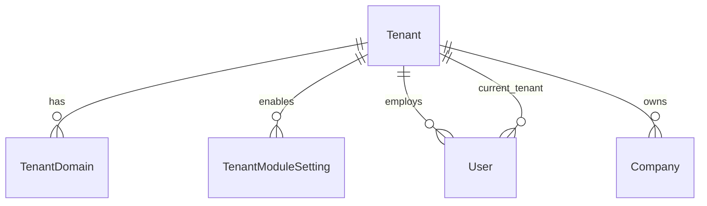
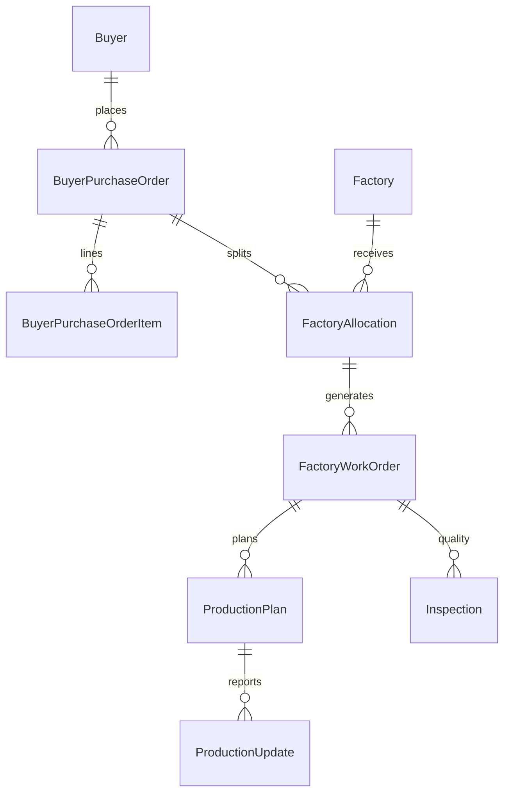
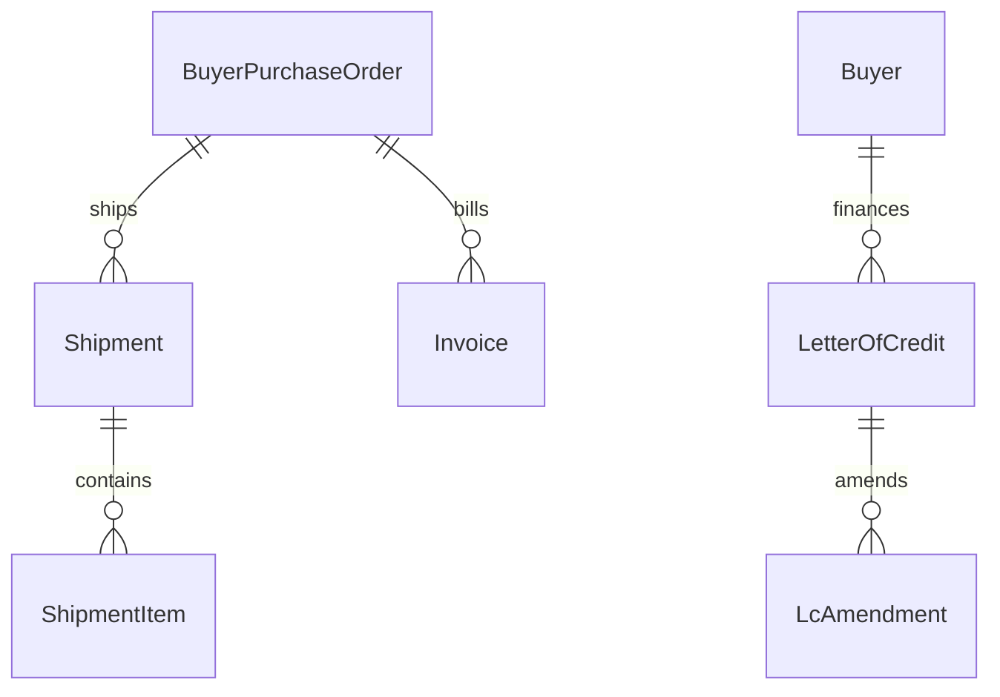

# TradeFlow — Entity Relationship Overview

TradeFlow is a **multi-tenant** buying-house platform. Most business tables include `tenant_id` and use a global scope for isolation.

## Tenancy & access



| Entity | Purpose |
|--------|---------|
| `tenants` | Buying house / customer account |
| `tenant_domains` | Hostnames for subdomain routing |
| `tenant_module_settings` | Per-tenant module toggles |
| `users` | Staff and portal users (`portal_type`, Spatie roles) |

## Partners & catalog

```mermaid
erDiagram
    Tenant ||--o{ Buyer : has
    Tenant ||--o{ Factory : has
    Tenant ||--o{ Supplier : has
    ProductCategory ||--o{ Style : contains
    Buyer ||--o{ Style : sources
    Style ||--o{ StyleColor : has
    Style ||--o{ StyleSize : has
```

## Commercial → orders → production



## Logistics & finance



## Workflow

| Entity | Links |
|--------|--------|
| `tasks` | Optional morph `taskable`, assigned user |
| `approvals` | Morph `approvable` approval chain |
| `audit_logs` / `activity_logs` | Cross-cutting observability |
| `notification_preferences` | Per-user channel/event toggles |

## Demo tenant snapshot

The `DemoSeeder` provisions **Global Apparel Sourcing Ltd** (`GAS`, slug `global-apparel`) with representative rows across the entities above for local evaluation.
